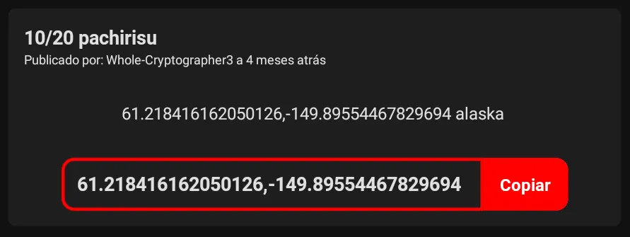

<h1 align="center">
   
  pGO Sniper
   
</h1>

<h4 align="center">Aplicativo desenvolvido com React Native com fins de aprendizado. Ele se conecta à API do Reddit (usando Axios) para exibir os tópicos do subreddit /r/PokemonGoSniping/.
</h4>

O aplicativo organiza os posts em uma lista detalhada, cada tópico tendo:

- Título (formato: `IV/LEVEL NOME_DO_POKEMON`)
- Autor do post
- Horário de criação
- Descrição do tópico
- Coordenadas(formato: `LAT, LNG`), com um botão para copiar rapidamente

## 👊 Propósito

Este foi o meu primeiro aplicativo desenvolvido com React Native. O principal objetivo do projeto foi aprofundar meus conhecimentos na tecnologia por meio da prática, ao mesmo tempo em que criava uma ferramenta útil para meus amigos e colegas "voadores".

Para mais detalhes do aplicativo, consulte a seção "Informações".

## 👍 Colabore

Colabore com o /r/PokemonGoSniping/

Link: https://www.reddit.com/r/PokemonGoSniping/new/

## 📝 Problemas Conhecidos

- ~Coordenadas deixadas apenas nos comentarios não aparecem no aplicativo.~

  - ~Não aparecem pois o aplicativo apenas pega o nome do tópico, descrição, autor e o horario(em Unix Timestamp).~
  - ~Tentei de tudo para pegar o primeiro comentario dos tópicos, mas não obtive sucesso.~ RESOLVIDO.

- ~A Lista não atualiza sozinha, sendo necessario abrir novamente o aplicativo.~

  - Ainda estou aprendendo sobre react-native e tentarei melhorar isso.
  - ~Porem o Horario de criação dos tópicos e atualizada de 1 em 1 minuto.~

- Pokemons que já sumiram (mais de 1 hora) continuam na lista.
  - Estou olhando uma forma de excluir da lista tópicos criados a mais de 1 hora.

## 💻 Download

Download: https://github.com/JNCJcoder/pGOSniper/releases

- Android: Lançado.
- iOS: Sem planos no momento.

## 📝 Informações

> Informações riscadas foram removidas.

- Dependências

  - axios
  - ~moment~
  - date-fns
  - ~prop-types~
  - react
  - react-native
  - ~react-moment~
  - react-navigation
  - react-navigation-stack
  - react-native-gesture-handler
  - @react-native-community/async-storage
  - ~@react-native-community/netinfo~
  - SWR

- Foi usado:
  - AJAX
  - Flexbox
  - ~MomentJS / react-moment~
  - date-fns
  - Flatlist
  - Offline First
  - Tema Claro/Escuro
  - Componentes (Flatlist)

## 📆 Histórico de lançamentos

- 1.0.1
  - getTopics Refatorado.
  - Opções do ReactNavigation Arrumadas.
  - Novas cores no Dark e Light mode.
  - Textos do README.md melhorados(e com imagem do novo design)
  - Nova Tentativa de organizar o codigo. :)

- 1.0.0
  - "@react-native-community/netinfo" Removido.
  - Adicionado SWR.
  - Guardando Darktheme e Firsttime em um mesmo objeto.
  - Codigo refatorado.

 

  
Versões Experimentais

- 0.0.8

  - Dependencias Atualizadas.
  - Codigo Usando 100% React Hooks.
  - Tamanho do TextInput das coordenadas Corrigido.
  - Tema Escuro mais Simples.
  - Tema padrão do celular e usado na primeira vez de uso.
  - "Leve" Arrumada no codigo.
  - Leve Melhoria de Desempenho.
  - Proptypes Removido.

- 0.0.7

  - Leve Melhoria de Desempenho.
  - Dependencias Atualizadas.
  - Imagem do README.md Atualizada.
  - A Flatlist dos "Topicos" agora e um Componente.
  - Consertado as Coordenadas, agora são pegas dos Comentarios do Subreddit.
  - Adicionado Prop-types.
  - Removido paddingBottom do container da Flatlist.

- 0.0.6

  - Dependências atualizadas.
  - Eslint e Prettier configurados.
  - Agora o codigo esta padronizado.
  - Styles otimizados, possível aumento de performance.
  - Styles do Sobre usando totalmente o Flexbox.
  - Caixa da coordenada corrigida quando usando o celular na horizontal.
  - Styles do Main usando totalmente o Flexbox.
  - Ambos os Styles estão usando reutilização de codigo.
  - Leves modificações no Main.

- 0.0.5

  - Melhorias minimas na performance.
  - Date() agora e iniciado apenas uma vez.
  - Corrigido problema no KeyExtractor.
  - Removido codigo de teste colocado na "versão 0.0.3".

- 0.0.4

  - Adicionado mensagem de primeiro uso.
  - MomentJS / react-moment trocado pelo date-fns.
  - Tema escuro com cores mais fracas.
  - Botão de mudar tema centralizado.

- 0.0.3

  - Adicionado tema escuro.
  - Adicionado botão para mudar tema.
  - O tema escolhido é lembrado.

- 0.0.2

  - Estrutura do StyleSheet arrumado.
  - Correção na estrutura do Sobre.
  - FlexBox melhor implementado.
  - StyleSheet para modo escuro preparada.
  - Usa ultima lista baixada quando sem internet.

- 0.0.1
  - Versão experimental lançada.

 

## ♻️ Contribuindo

1. Faça o _fork_ do projeto (<https://github.com/JNCJcoder/pGOSniper/fork>)
2. Crie uma _branch_ para sua modificação (`git checkout -b feature/fooBar`)
3. Faça o _commit_ (`git commit -am 'Add some fooBar'`)
4. _Push_ (`git push origin feature/fooBar`)
5. Crie um novo _Pull Request_
